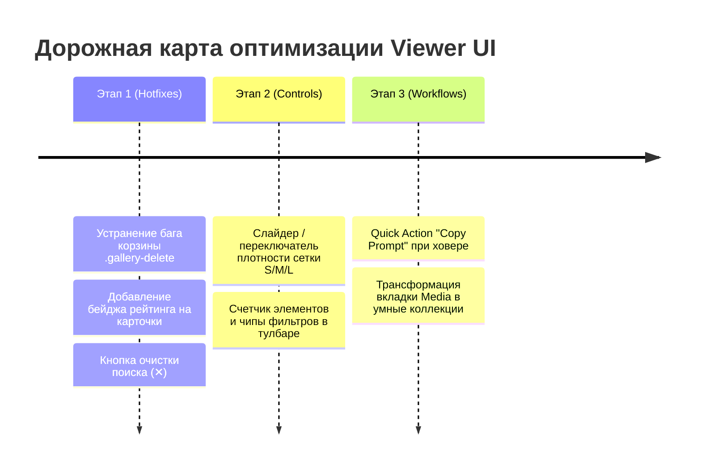

# Аудит UI/UX: Страница Viewer (ComfyUI Meta Viewer)

Данный документ содержит детальный анализ проблем интерфейса страницы **Viewer** (`/`), выявленных в результате визуального аудита скриншота рабочей сессии и ревизии исходного кода фронтенда.

---

## Сводная таблица проблем

| # | Категория | Проблема | Файлы / Компоненты | Влияние на UX | Приоритет |
|---|---|---|---|---|:---:|
| 1 | **Визуальный баг / Безопасность** | Иконка корзины видна на превью без наведения | [gallery.css](file:///f:/ComfyUI_windows_portable/comfy-meta-viewer/app/static/css/features/gallery.css#L170-L175), [gallery.js](file:///f:/ComfyUI_windows_portable/comfy-meta-viewer/app/static/js/gallery.js#L106-L108) | Засоряет изображение, риск случайного удаления | **✅ Исправлено (P0)** |
| 2 | **Информативность** | Отсутствие бейджа рейтинга на карточках | [gallery.js](file:///f:/ComfyUI_windows_portable/comfy-meta-viewer/app/static/js/gallery.js#L70-L115), [gallery.css](file:///f:/ComfyUI_windows_portable/comfy-meta-viewer/app/static/css/features/gallery.css) | Фильтрация по звездам работает вслепую | **✅ Исправлено (P1)** |
| 3 | **Эргономика сетки** | Отсутствие управления размером плитки (Zoom) | [gallery.css](file:///f:/ComfyUI_windows_portable/comfy-meta-viewer/app/static/css/features/gallery.css#L8-L16), [index.html](file:///f:/ComfyUI_windows_portable/comfy-meta-viewer/app/templates/index.html#L253-L318) | Невозможность быстрого сжатия или крупного просмотра | **✅ Реализовано (P1)** |
| 4 | **Поиск** | Нет кнопки быстрой очистки инпута (✕) | [index.html](file:///f:/ComfyUI_windows_portable/comfy-meta-viewer/app/templates/index.html#L258-L262), [search-bar.js](file:///f:/ComfyUI_windows_portable/comfy-meta-viewer/app/static/js/components/search-bar.js#L11-L68) | Неудобный сброс поисковой фильтрации | **✅ Исправлено (P2)** |
| 5 | **Архитектура UI** | Вкладка `Media` в сайдбаре полностью дублирует галерею | [index.html](file:///f:/ComfyUI_windows_portable/comfy-meta-viewer/app/templates/index.html#L169-L248), [sidebar.js](file:///f:/ComfyUI_windows_portable/comfy-meta-viewer/app/static/js/features/sidebar.js#L93-L120) | Бессмысленная трата экранного пространства (260px) | **P2 (Средний)** |
| 6 | **Иерархия тулбара** | Нет счетчика элементов и индикаторов активных фильтров | [index.html](file:///f:/ComfyUI_windows_portable/comfy-meta-viewer/app/templates/index.html#L253-L257), [content.css](file:///f:/ComfyUI_windows_portable/comfy-meta-viewer/app/static/css/layout/content.css#L28-L51) | Потеря контекста при скрытом сайдбаре | **✅ Реализовано (P2)** |
| 7 | **Микро-действия** | Отсутствие быстрых экшенов на карточке (Copy Prompt) | [gallery.js](file:///f:/ComfyUI_windows_portable/comfy-meta-viewer/app/static/js/gallery.js#L110-L114) | Лишние клики в контекстное меню и лайтбокс | **P3 (Низкий)** |
| 8 | **Контраст оверлея** | Недостаточная глубина градиента на ярких изображениях | [gallery.css](file:///f:/ComfyUI_windows_portable/comfy-meta-viewer/app/static/css/features/gallery.css#L65-L86) | Текст имени файла теряется на белых фонах | **P3 (Низкий)** |

---

## Детальное описание проблем

### 1. Перманентная иконка корзины на превью (`.gallery-delete`)

> [!CAUTION]
> **Критический UX-дефект**: кнопка удаления физически перекрывает часть генерации и не скрывается до наведения курсора. Случайный клик приводит к исключению файла из базы данных.

* **Локализация в коде:**
  * [gallery.css: L170-175](file:///f:/ComfyUI_windows_portable/comfy-meta-viewer/app/static/css/features/gallery.css#L170-L175)
  * [gallery.js: L106-L108](file:///f:/ComfyUI_windows_portable/comfy-meta-viewer/app/static/js/gallery.js#L106-L108)
* **Причина:**
  В CSS-классе `.gallery-delete` заданы координаты `top: 9px; right: 9px; z-index: 2`, но **не задан** базовый `opacity: 0` и `pointer-events: none`. В отличие от `.sidebar-delete` (где в [sidebar.css](file:///f:/ComfyUI_windows_portable/comfy-meta-viewer/app/static/css/layout/sidebar.css#L887) прозрачность установлена), в галерее кнопка видна всегда.
* **Симптом на экране:**
  На присланном скриншоте на карточках (например, в колонках 1, 3, 5, 6, 7) прямо поверх артов в верхнем правом углу отображается иконка мусорной корзины.
* **Предлагаемое решение:**
  ```css
  .gallery-delete {
      position: absolute;
      top: 8px;
      right: 8px;
      z-index: 3;
      opacity: 0;
      pointer-events: none;
      width: 28px;
      height: 28px;
      display: inline-flex;
      align-items: center;
      justify-content: center;
      background: color-mix(in srgb, var(--bg) 75%, transparent);
      backdrop-filter: blur(8px);
      -webkit-backdrop-filter: blur(8px);
      border: 1px solid rgba(255, 255, 255, 0.12);
      border-radius: var(--radius-sm);
      color: var(--text-muted);
      transition: all var(--transition-fast);
  }

  .gallery-card:hover .gallery-delete,
  .gallery-card:focus-within .gallery-delete {
      opacity: 1;
      pointer-events: auto;
  }

  .gallery-delete:hover {
      background: var(--red);
      color: #fff;
      border-color: var(--red);
      transform: scale(1.08);
  }
  ```

---

### 2. Отсутствие индикатора рейтинга на карточках галереи

* **Локализация в коде:**
  * [gallery.js: L70-L115](file:///f:/ComfyUI_windows_portable/comfy-meta-viewer/app/static/js/gallery.js#L70-L115) (функция `galleryCardHtml`)
* **Причина:**
  Свойство `img.rating` сохраняется в БД и фильтруется через селектор `Rating` в тулбаре, но шаблон карточки вообще не отображает рейтинг. 
* **Симптом на экране:**
  Пользователь не видит, какие работы помечены как удачные (5 звезд), а какие еще не отсортированы.
* **Предлагаемое решение:**
  Рендерить аккуратный компактный бейдж в левом верхнем углу при `img.rating > 0`:
  ```html
  <span class="gallery-rating-badge" title="Rating: ${img.rating}">
      ★ ${img.rating}
  </span>
  ```
  Со стилизацией золотистого/янтарного акцента с размытием фона (`rgba(0, 0, 0, 0.6)`).

---

### 3. Отсутствие регулировки масштаба сетки (Grid Density / Zoom)

> [!TIP]
> Возможность масштабировать сетку — ключевая функция любого профессионального просмотрщика изображений (Lightroom, Eagle, Hydrus, Apple Photos).

* **Локализация в коде:**
  * [gallery.css: L10](file:///f:/ComfyUI_windows_portable/comfy-meta-viewer/app/static/css/features/gallery.css#L10)
  * [index.html: L275-L317](file:///f:/ComfyUI_windows_portable/comfy-meta-viewer/app/templates/index.html#L275-L317)
* **Причина:**
  Размер колонки жестко зафиксирован: `repeat(auto-fill, minmax(220px, 1fr))`.
* **Симптом на экране:**
  При большой коллекции (на скриншоте загружено 5 706 медиафайлов) невозможно:
  * Включить **компактный режим (140–160px)** для быстрого сканирования сотен картинок;
  * Включить **крупный режим (380–480px)** для детального рассмотрения лиц, текстур и качества генерации без перехода в лайтбокс.
* **Предлагаемое решение:**
  1. Вынести минимальный размер в CSS-переменную `--gallery-card-min: 220px;`.
  2. Добавить в правую часть контекстного тулбара слайдер или сегментированный переключатель:
     ```html
     <div class="gallery-density-toggle">
         <button data-density="sm" title="Small (Dense)">S</button>
         <button data-density="md" class="active" title="Medium">M</button>
         <button data-density="lg" title="Large">L</button>
     </div>
     ```
  3. Сохранять значение в `localStorage` (`cmv_gallery_density`).

---

### 4. Поисковая строка без кнопки сброса (✕)

* **Локализация в коде:**
  * [index.html: L258-L262](file:///f:/ComfyUI_windows_portable/comfy-meta-viewer/app/templates/index.html#L258-L262)
  * [search-bar.js: L11-L40](file:///f:/ComfyUI_windows_portable/comfy-meta-viewer/app/static/js/components/search-bar.js#L11-L40)
* **Причина:**
  В контейнере `.viewer-context-search` есть только `<input>` и `<button id="search-settings-btn">`.
* **Симптом на экране:**
  При вводе запроса очистить поле можно только выделением текста и нажатием клавиши `Backspace` или `Escape` с клавиатуры. На сенсорных экранах или при работе одной мышью это неудобно.
* **Предлагаемое решение:**
  Добавить кнопку очистки `<button class="search-clear-btn" id="search-clear-btn" hidden>×</button>`, которая появляется при `input.value !== ''` и мгновенно сбрасывает фильтр.

---

### 5. Архитектурная избыточность: Вкладка `Media` в левом сайдбаре

* **Локализация в коде:**
  * [index.html: L169-L248](file:///f:/ComfyUI_windows_portable/comfy-meta-viewer/app/templates/index.html#L169-L248)
  * [sidebar.js: L93-L120](file:///f:/ComfyUI_windows_portable/comfy-meta-viewer/app/static/js/features/sidebar.js#L93-L120)
* **Причина:**
  Сайдбар содержит 3 вкладки: `Folders`, `Albums` и `Media`. При этом во вкладке `Media` отрисовывается `.image-list` — миниатюрная колонка из тех же самых картинок, которые параллельно выводятся в центральной рабочей области.
* **Симптом на экране:**
  Левый сайдбар шириной ~260px дублирует центральный экран, отнимая место у основной сетки.
* **Предлагаемое решение:**
  Переориентировать вкладку `Media` на **Smart Views / Быстрые выборки**:
  ```mermaid
  graph LR
      A[Сайдбар: Навигация] --> B[📁 Sources / Папки источников]
      A --> C[📚 Albums / Пользовательские альбомы]
      A --> D[✨ Quick Views / Фильтры]
      D --> D1[⭐ Избранное: 4-5 звезд]
      D --> D2[🎬 Только видео]
      D --> D3[🕒 Недавние генерации]
      D --> D4[❓ Без оценки]
  ```

---

### 6. Слабая контекстная информативность тулбара

* **Локализация в коде:**
  * [index.html: L253-L257](file:///f:/ComfyUI_windows_portable/comfy-meta-viewer/app/templates/index.html#L253-L257)
  * [content.css: L28-L51](file:///f:/ComfyUI_windows_portable/comfy-meta-viewer/app/static/css/layout/content.css#L28-L51)
* **Причина:**
  В тулбаре написано статичное название коллекции `#viewer-collection-name` (`Gallery` / `All Media`). Количество загруженных файлов (`50 / 5706`) привязано к DOM сайдбара (`#image-count`).
* **Симптом на экране:**
  Если пользователь свернет сайдбар (горячей клавишей `B` или кнопкой бургера), он теряет информацию о размере текущей выборки и количестве загруженных элементов.
* **Предлагаемое решение:**
  1. Отображать счетчик прямо возле названия: `All Media` `<span class="badge">5 706</span>`.
  2. При активных фильтрах (поиск, рейтинг, тип медиа) выводить визуальный тег с возможностью сброса в 1 клик (`Reset filters`).

---

### 7. Отсутствие быстрых действий на карточке при ховере

* **Локализация в коде:**
  * [gallery.js: L110-L114](file:///f:/ComfyUI_windows_portable/comfy-meta-viewer/app/static/js/gallery.js#L110-L114)
* **Причина:**
  При наведении на карточку всплывает только текстовая плашка `.card-info` с именем файла и габаритами.
* **Симптом на экране:**
  Для пользователей ComfyUI копирование удачного положительного промпта (`positive_prompt`) — одна из самых частых рутинных задач. Сейчас для этого необходимо либо открывать лайтбокс, либо делать правый клик и искать нужный пункт в длинном контекстном меню.
* **Предлагаемое решение:**
  Добавить в оверлей плашки компактную кнопку `Copy Prompt` (иконка копирования), которая считывает `img.prompt_parameters?.positive_prompt` и копирует в буфер обмена с мгновенным тостом.

---

### 8. Контрастность и визуальная глубина оверлея карточки

* **Локализация в коде:**
  * [gallery.css: L65-L80](file:///f:/ComfyUI_windows_portable/comfy-meta-viewer/app/static/css/features/gallery.css#L65-L80)
* **Причина:**
  Градиент `.card-info` начинается с `rgba(11, 15, 18, 0.96)` и быстро уходит в прозрачность через линейный переход с маской.
* **Симптом на экране:**
  На изображениях с яркими, белыми или пестрыми нижними границами текст размера `10px` и `12px` сливается с фоном изображения при быстром скролле.
* **Предлагаемое решение:**
  Использовать кинематографичный scrim-градиент с плавным распределением непрозрачности и увеличенным `backdrop-filter: blur(10px)`.

---

## План внедрения улучшений


