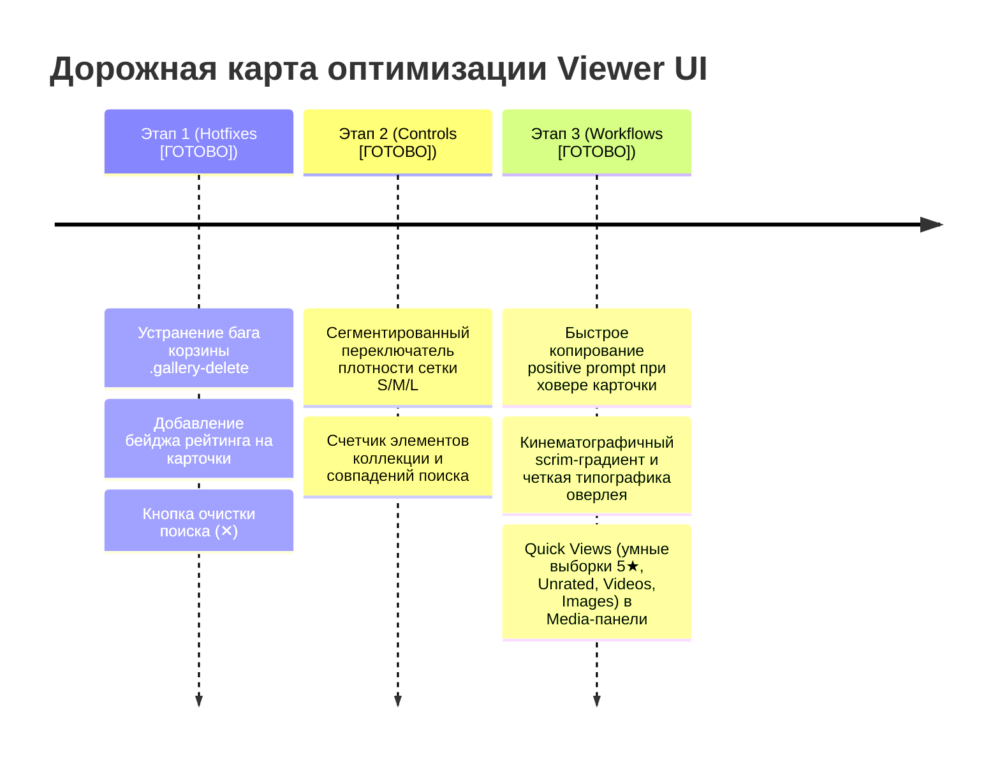

# Аудит UI/UX: Страница Viewer (ComfyUI Meta Viewer)

Данный документ содержит детальный анализ проблем интерфейса страницы **Viewer** (`/`), выявленных в результате визуального аудита скриншота рабочей сессии и ревизии исходного кода фронтенда.

---

## Сводная таблица проблем

| # | Категория | Проблема | Файлы / Компоненты | Влияние на UX | Приоритет |
|---|---|---|---|---|:---:|
| 1 | **Визуальный баг / Безопасность** | Иконка корзины видна на превью без наведения | [gallery.css](../app/static/css/features/gallery.css#L170-L175), [gallery.js](../app/static/js/gallery.js#L106-L108) | Засоряет изображение, риск случайного удаления | **✅ Исправлено (P0)** |
| 2 | **Информативность** | Отсутствие бейджа рейтинга на карточках | [gallery.js](../app/static/js/gallery.js#L70-L115), [gallery.css](../app/static/css/features/gallery.css) | Фильтрация по звездам работает вслепую | **✅ Исправлено (P1)** |
| 3 | **Эргономика сетки** | Отсутствие управления размером плитки (Zoom) | [gallery.css](../app/static/css/features/gallery.css#L8-L16), [index.html](../app/templates/index.html#L253-L318) | Невозможность быстрого сжатия или крупного просмотра | **✅ Реализовано (P1)** |
| 4 | **Поиск** | Нет кнопки быстрой очистки инпута (✕) | [index.html](../app/templates/index.html#L258-L262), [search-bar.js](../app/static/js/components/search-bar.js#L11-L68) | Неудобный сброс поисковой фильтрации | **✅ Исправлено (P2)** |
| 5 | **Архитектура UI** | Вкладка `Media` в сайдбаре полностью дублирует галерею | [index.html](../app/templates/index.html#L169-L248), [sidebar.js](../app/static/js/features/sidebar.js#L93-L120) | Бессмысленная трата экранного пространства (260px) | **Исправлено (2026-10-06)** |
| 6 | **Иерархия тулбара** | Нет счетчика элементов и индикаторов активных фильтров | [index.html](../app/templates/index.html#L253-L257), [content.css](../app/static/css/layout/content.css#L28-L51) | Потеря контекста при скрытом сайдбаре | **✅ Реализовано (P2)** |
| 7 | **Микро-действия** | Отсутствие быстрых экшенов на карточке (Copy Prompt) | [gallery.js](../app/static/js/gallery.js#L110-L114) | Лишние клики в контекстное меню и лайтбокс | **Реализовано; проверено 2026-10-06** |
| 8 | **Контраст оверлея** | Недостаточная глубина градиента на ярких изображениях | [gallery.css](../app/static/css/features/gallery.css#L65-L86) | Текст имени файла теряется на белых фонах | **Реализовано; проверено 2026-10-06** |

---

## Детальное описание проблем

### 1. Перманентная иконка корзины на превью (`.gallery-delete`)

> [!CAUTION]
> **Критический UX-дефект**: кнопка удаления физически перекрывает часть генерации и не скрывается до наведения курсора. Случайный клик приводит к исключению файла из базы данных.

* **Локализация в коде:**
  * [gallery.css: L170-175](../app/static/css/features/gallery.css#L170-L175)
  * [gallery.js: L106-L108](../app/static/js/gallery.js#L106-L108)
* **Причина:**
  В CSS-классе `.gallery-delete` заданы координаты `top: 9px; right: 9px; z-index: 2`, но **не задан** базовый `opacity: 0` и `pointer-events: none`. В отличие от `.sidebar-delete` (где в [sidebar.css](../app/static/css/layout/sidebar.css#L887) прозрачность установлена), в галерее кнопка видна всегда.
* **Симптом на экране:**
  На присланном скриншоте на карточках (например, в колонках 1, 3, 5, 6, 7) прямо поверх артов в верхнем правом углу отображается иконка мусорной корзины.
* **Предлагаемое решение:**
  ```css
  .gallery-delete {
      position: absolute;
      top: 8px;
      right: 8px;
      z-index: 3;
      opacity: 0;
      pointer-events: none;
      width: 28px;
      height: 28px;
      display: inline-flex;
      align-items: center;
      justify-content: center;
      background: color-mix(in srgb, var(--bg) 75%, transparent);
      backdrop-filter: blur(8px);
      -webkit-backdrop-filter: blur(8px);
      border: 1px solid rgba(255, 255, 255, 0.12);
      border-radius: var(--radius-sm);
      color: var(--text-muted);
      transition: all var(--transition-fast);
  }

  .gallery-card:hover .gallery-delete,
  .gallery-card:focus-within .gallery-delete {
      opacity: 1;
      pointer-events: auto;
  }

  .gallery-delete:hover {
      background: var(--red);
      color: #fff;
      border-color: var(--red);
      transform: scale(1.08);
  }
  ```

---

### 2. Отсутствие индикатора рейтинга на карточках галереи

* **Локализация в коде:**
  * [gallery.js: L70-L115](../app/static/js/gallery.js#L70-L115) (функция `galleryCardHtml`)
* **Причина:**
  Свойство `img.rating` сохраняется в БД и фильтруется через селектор `Rating` в тулбаре, но шаблон карточки вообще не отображает рейтинг. 
* **Симптом на экране:**
  Пользователь не видит, какие работы помечены как удачные (5 звезд), а какие еще не отсортированы.
* **Предлагаемое решение:**
  Рендерить аккуратный компактный бейдж в левом верхнем углу при `img.rating > 0`:
  ```html
  <span class="gallery-rating-badge" title="Rating: ${img.rating}">
      ★ ${img.rating}
  </span>
  ```
  Со стилизацией золотистого/янтарного акцента с размытием фона (`rgba(0, 0, 0, 0.6)`).

---

### 3. Отсутствие регулировки масштаба сетки (Grid Density / Zoom)

> [!TIP]
> Возможность масштабировать сетку — ключевая функция любого профессионального просмотрщика изображений (Lightroom, Eagle, Hydrus, Apple Photos).

* **Локализация в коде:**
  * [gallery.css: L10](../app/static/css/features/gallery.css#L10)
  * [index.html: L275-L317](../app/templates/index.html#L275-L317)
* **Причина:**
  Размер колонки жестко зафиксирован: `repeat(auto-fill, minmax(220px, 1fr))`.
* **Симптом на экране:**
  При большой коллекции (на скриншоте загружено 5 706 медиафайлов) невозможно:
  * Включить **компактный режим (140–160px)** для быстрого сканирования сотен картинок;
  * Включить **крупный режим (380–480px)** для детального рассмотрения лиц, текстур и качества генерации без перехода в лайтбокс.
* **Предлагаемое решение:**
  1. Вынести минимальный размер в CSS-переменную `--gallery-card-min: 220px;`.
  2. Добавить в правую часть контекстного тулбара слайдер или сегментированный переключатель:
     ```html
     <div class="gallery-density-toggle">
         <button data-density="sm" title="Small (Dense)">S</button>
         <button data-density="md" class="active" title="Medium">M</button>
         <button data-density="lg" title="Large">L</button>
     </div>
     ```
  3. Сохранять значение в `localStorage` (`cmv_gallery_density`).

---

### 4. Поисковая строка без кнопки сброса (✕)

* **Локализация в коде:**
  * [index.html: L258-L262](../app/templates/index.html#L258-L262)
  * [search-bar.js: L11-L40](../app/static/js/components/search-bar.js#L11-L40)
* **Причина:**
  В контейнере `.viewer-context-search` есть только `<input>` и `<button id="search-settings-btn">`.
* **Симптом на экране:**
  При вводе запроса очистить поле можно только выделением текста и нажатием клавиши `Backspace` или `Escape` с клавиатуры. На сенсорных экранах или при работе одной мышью это неудобно.
* **Предлагаемое решение:**
  Добавить кнопку очистки `<button class="search-clear-btn" id="search-clear-btn" hidden>×</button>`, которая появляется при `input.value !== ''` и мгновенно сбрасывает фильтр.

---

### 5. Архитектурная избыточность: Вкладка `Media` в левом сайдбаре

* **Локализация в коде:**
  * [index.html: L169-L248](../app/templates/index.html#L169-L248)
  * [sidebar.js: L93-L120](../app/static/js/features/sidebar.js#L93-L120)
* **Причина:**
  Сайдбар содержит 3 вкладки: `Folders`, `Albums` и `Media`. При этом во вкладке `Media` отрисовывается `.image-list` — миниатюрная колонка из тех же самых картинок, которые параллельно выводятся в центральной рабочей области.
* **Симптом на экране:**
  Левый сайдбар шириной ~260px дублирует центральный экран, отнимая место у основной сетки.
* **Предлагаемое решение:**
  Переориентировать вкладку `Media` на **Smart Views / Быстрые выборки**:
  ```mermaid
  graph LR
      A[Сайдбар: Навигация] --> B[📁 Sources / Папки источников]
      A --> C[📚 Albums / Пользовательские альбомы]
      A --> D[✨ Quick Views / Фильтры]
      D --> D1[⭐ Избранное: 4-5 звезд]
      D --> D2[🎬 Только видео]
      D --> D3[🕒 Недавние генерации]
      D --> D4[❓ Без оценки]
  ```

---

### 6. Слабая контекстная информативность тулбара

* **Локализация в коде:**
  * [index.html: L253-L257](../app/templates/index.html#L253-L257)
  * [content.css: L28-L51](../app/static/css/layout/content.css#L28-L51)
* **Причина:**
  В тулбаре написано статичное название коллекции `#viewer-collection-name` (`Gallery` / `All Media`). Количество загруженных файлов (`50 / 5706`) привязано к DOM сайдбара (`#image-count`).
* **Симптом на экране:**
  Если пользователь свернет сайдбар (горячей клавишей `B` или кнопкой бургера), он теряет информацию о размере текущей выборки и количестве загруженных элементов.
* **Предлагаемое решение:**
  1. Отображать счетчик прямо возле названия: `All Media` `<span class="badge">5 706</span>`.
  2. При активных фильтрах (поиск, рейтинг, тип медиа) выводить визуальный тег с возможностью сброса в 1 клик (`Reset filters`).

---

### 7. Отсутствие быстрых действий на карточке при ховере

* **Локализация в коде:**
  * [gallery.js: L110-L114](../app/static/js/gallery.js#L110-L114)
* **Причина:**
  При наведении на карточку всплывает только текстовая плашка `.card-info` с именем файла и габаритами.
* **Симптом на экране:**
  Для пользователей ComfyUI копирование удачного положительного промпта (`positive_prompt`) — одна из самых частых рутинных задач. Сейчас для этого необходимо либо открывать лайтбокс, либо делать правый клик и искать нужный пункт в длинном контекстном меню.
* **Предлагаемое решение:**
  Добавить в оверлей плашки компактную кнопку `Copy Prompt` (иконка копирования), которая считывает `img.prompt_parameters?.positive_prompt` и копирует в буфер обмена с мгновенным тостом.

---

### 8. Контрастность и визуальная глубина оверлея карточки

* **Локализация в коде:**
  * [gallery.css: L65-L80](../app/static/css/features/gallery.css#L65-L80)
* **Причина:**
  Градиент `.card-info` начинается с `rgba(11, 15, 18, 0.96)` и быстро уходит в прозрачность через линейный переход с маской.
* **Симптом на экране:**
  На изображениях с яркими, белыми или пестрыми нижними границами текст размера `10px` и `12px` сливается с фоном изображения при быстром скролле.
* **Предлагаемое решение:**
  Использовать кинематографичный scrim-градиент с плавным распределением непрозрачности и увеличенным `backdrop-filter: blur(10px)`.

---

## План внедрения улучшений



### Статус первоначального внедрения
- [x] **Этап 1 (Коммит `daeb37b`):** Скрыта корзина вне ховера, бейдж рейтинга ★ на карточках, кнопка `✕` в поиске.
- [x] **Этап 2 (Коммит `aa9a057`):** Переключатель плотности сетки `S` (150px) / `M` (220px) / `L` (360px), динамический пересчет masonry-сетки, счетчики в тулбаре и живой счетчик найденных совпадений поиска.
- [x] **Этап 3 (Текущий этап):**
  - **Quick Action "Copy Prompt"** с анимированным подтверждением и всплывающим тостом прямо с карточки без перехода в лайтбокс;
  - **Cinematic Scrim Overlay**: глубокий бесшовный градиент без артефактов маски, улучшенная контрастность и четкость на ярких фонах;
  - **Quick Views в сайдбаре (вкладка Media)**: умные чипы быстрого переключения выборок (`All`, `5★ Top`, `Unrated`, `Videos`, `Images`, кнопка `Reset`).


## Доработка UI/UX — 2026-10-06

Первоначальные этапы выше описывают исторический аудит и предложения. При проверке
реального интерфейса этап 3 потребовал исправлений; его прежняя отметка «ГОТОВО»
не означала отсутствие регрессий. Текущее устройство Viewer приведено ниже.

- [x] Удалены `#panel-images`, `#image-list`, рендер миниатюр и их `IntersectionObserver`.
  Сайдбар содержит навигацию и выборки; карточки медиа создаются только в рабочей области.
  Данные глобальной коллекции пока сохраняются в состоянии приложения для совместимости
  с существующими загрузчиками и лайтбоксом, но не создают второй список DOM.
- [x] Убраны старые правила `.sidebar-panel` и активация вкладок при загрузке.
  Sources и Albums занимают высоту содержимого и прокручиваются вместе с навигацией.
- [x] Эмодзи в навигации, пустом состоянии папок и справке Viewer заменены SVG либо удалены.
  Иконки навигации, рейтинга и темы используют локальный спрайт
  [Lucide](https://lucide.dev/license); уведомления о лицензии находятся в
  [LICENSE.lucide.txt](../app/static/icons/LICENSE.lucide.txt).
- [x] `Reset filters` обрабатывается в секции Library, сбрасывает поиск, рейтинг и тип
  медиа; смена серверных фильтров выполняет одну загрузку текущей коллекции.
  `All Media` очищает фильтры и открывает глобальную коллекцию.
- [x] Счетчик использует текущую коллекцию: пустой результат показывает `0`, а
  маленький альбом не наследует размер глобального списка. Поиск явно обозначен как
  поиск среди загруженных медиа; при отсутствии совпадений доступна очистка.
- [x] При вводе поиска автопагинация приостановлена: скрытые карточки больше не
  провоцируют автоматическую загрузку всей библиотеки. Кнопка `Load more media to search`
  добавляет следующую порцию в область поиска по явному запросу пользователя.
- [x] Тулбар адаптируется к ширине рабочей области, включая изменение ширины сайдбара.
  Поле поиска получает полноценную строку; верхняя навигация на телефоне отделена от действий.
- [x] Исправлен `[hidden]` у кнопки очистки поиска. Добавлены состояния `aria-pressed`
  выборок, `aria-expanded` секций, видимый клавиатурный фокус. Источник открывается
  нативной кнопкой; карточка открывается Enter / Space, Copy Prompt виден при фокусе.
- [x] Убраны подъем и увеличение изображения при наведении; scrim и быстрые действия
  сохранены, повторные правила плотности устранены.

### Проверка

Регрессионные сценарии: отсутствие второго списка миниатюр, счетчик пустой коллекции
при заполненном глобальном кеше, счетчик небольшого альбома, поиск без совпадений,
очистка поиска, фильтр Videos, сброс фильтров, клавиатурный фокус и адаптивная раскладка.
Автоматическая регрессия счетчиков и отсутствия старого контейнера:
[test_viewer_sidebar.mjs](../tests/test_viewer_sidebar.mjs).

Результаты финальной проверки: ESLint без ошибок и предупреждений; `npm test` —
30 passed; `python -m pytest tests -q --disable-warnings` — 523 passed,
88 subtests passed. Браузер: 1280×720 и 390×844, отсутствие второго списка DOM,
отсутствие горизонтального переполнения, отдельные строки навигации и действий
на телефоне; ошибок и предупреждений в консоли не обнаружено. Copy Prompt вернул
подтверждение `Prompt copied!`; Enter открыл лайтбокс видимой карточки, Tab показал
действия и видимую рамку фокуса. В сценарии поиска число карточек оставалось 50; одно нажатие
`Load more media to search` увеличило его до 100, автозагрузчик оставался скрыт.
Подтверждено, что мобильный сайдбар перекрывает
тулбар, а названия источников не уступают место невидимым кнопкам управления.

Инструкции навыков, примененных для этой доработки: `ui-skills-root`, `baseline-ui`,
`ui-design` (режим Audit / Deslop; feature-playbooks, aesthetic-direction,
interaction-focus-visible, interaction-keyboard-operable, states-layout-shift).
Полного аудита всех страниц приложения эта доработка не проводит.


## Sources и Albums — рефакторинг 2026-10-06

Продолжение доработки боковой навигации Viewer по запросу пользователя.

- [x] Общая раскладка строк и плиток: название, постоянный счётчик, одинаковые
  отступы и состояния выбора. Длинные названия сокращаются в строках и занимают
  максимум две строки в плитках; полное название доступно в подсказке.
- [x] У Sources вместо четырёх конкурирующих кнопок используется одно меню
  действий с текстовыми подписями и локальными SVG Lucide. Нативный popover
  закрывается Escape и кликом снаружи, возвращает клавиатурный фокус, помещается
  в экран. На телефоне кнопки меню и секций имеют области нажатия 44 px.
- [x] Live-обновление источника сохраняет открытое меню и текущий фокус,
  включая фокус в другой строке. Статус, рекурсивность и прогресс остаются
  отдельными читаемыми признаками, счётчик не скрывается при наведении.
- [x] У Albums убраны декоративные слои, градиенты, повороты и увеличение
  обложки. Одна обложка, название и количество медиа; пустой альбом использует
  спокойный SVG placeholder и подпись `Empty album`. Управление альбомами
  доступно через Library, drag-and-drop target сохранён.
- [x] Альбомы считают `items`, источники с видео показывают общее количество
  медиа. Прогресс использует `processed_asset_count / asset_count`, ограничен
  диапазоном 0–100%; неизвестный итог не выдаётся за нулевое завершение.
  SSE источников теперь передаёт количества видео, медиа и обработанных медиа.
- [x] Устранён второй путь рендера текущей коллекции в API: загрузка делегирует
  обновление общему `events.renderCurrentContent`. Название, счётчик,
  `aria-current` и выделение синхронизированы при переходах source → album →
  source, открытии пустого альбома и выборе All Media.
- [x] Пустые состояния Sources и Albums приведены к общей компактной раскладке;
  служебные emoji в заголовках общих диалогов убраны.

### Проверка Sources / Albums

ESLint и Ruff для изменённых Python-файлов — без замечаний. `npm test` — 36 passed;
полный `python -m pytest tests -q --disable-warnings` — 524 passed,
88 subtests passed. Добавлены проверки смешанного количества медиа, прогресса,
нулевого и неизвестного итога, состояния disabled, смены выделения между типами
коллекций и состава SSE payload:
[test_viewer_collections.mjs](../tests/test_viewer_collections.mjs),
[test_viewer_sidebar.mjs](../tests/test_viewer_sidebar.mjs),
[test_viewer_collections.py](../tests/test_viewer_collections.py).

Браузер: 1280×720, 1280×900 и 390×844; список и плитки, длинные названия,
пустой альбом, обложки, available / disabled / unavailable / processing,
переходы в альбом с одним элементом и пустой альбом, возврат в источник,
сортировка альбомов, клавиатурное открытие и закрытие меню, отсутствие
горизонтального переполнения и старых контейнеров миниатюр.
Изолированное превью использовало настоящий шаблон, CSS и ES modules с
тестовыми API-ответами; пользовательская библиотека не заполнялась тестовыми
альбомами. SSE-сценарий 63% → 64% подтвердил сохранение popover и фокуса.

UI применяется после обновления страницы. Для обновлённого серверного SSE payload
нужен перезапуск работающего Viewer; маршрут проверен через Flask test client.


## Top rated: неоднозначная метка — 2026-10-06

По сообщению пользователя проверена версия о пяти оставшихся рейтингах от
удалённого источника. Выделенная цифра `5` была статическим параметром фильтра
`rating=5`, а не количеством записей. Оформление этой метки как badge счётчика
вводило в заблуждение. Она заменена общей подписью `Top rated (5 stars)`;
неиспользуемые правила `.nav-item-badge` удалены.

Рабочая SQLite-база проверена соединением `mode=ro`: на момент проверки один
источник, 5706 медиа без пользовательского рейтинга, 0 записей с рейтингом 5.
`/api/images?rating=5` вернул `total=0` и пустой список. Проверки потерянных связей
images → folders, album_images / image_tags / item_positions / ai_ratings → images
и `PRAGMA foreign_key_check` нарушений не выявили. Удаление данных для исправления
этой UI-проблемы не потребовалось.

Регрессия `test_forgetting_rated_source_clears_ratings_before_indexing_a_new_source`
в [test_library.py](../tests/test_library.py) воспроизводит пять оценённых файлов,
избранное, заметку, теги, альбом с обложкой, порядок и AI-оценку. После штатного
DELETE источника связанные записи очищены, исходные файлы остаются на диске;
новая папка с таким же именем файла не наследует оценки или другие атрибуты.
Браузерная проверка нового названия подтвердила отсутствие badge и 0 результатов
при выборе Top rated; возвращён исходный режим фильтрации.

Проверка после исправления: полный pytest — 525 passed, 88 subtests passed;
ESLint и Ruff изменённого теста — без замечаний.


## Масштаб Viewer — возврат прежних размеров — 2026-10-06

После визуальной оценки пользователь попросил отменить увеличение интерфейса.
Возвращены прежние размеры шрифтов, кнопок, отступов и коллекций, высота верхней
панели и порог переноса тулбара. Дополнительный stylesheet увеличенного масштаба
удалён. Исправления превью, SVG-иконки, Sources / Albums, фильтры и усечение
длинного статуса источника сохранены. Размер медиа-превью по-прежнему задаётся S/M/L.


## Кнопка «Наверх» — 2026-10-10

Общий компонент [scroll-top-button.js](../app/static/js/components/scroll-top-button.js)
и стили [scroll-top.css](../app/static/css/components/scroll-top.css) подключены
в галерее Viewer и в Library. Галерея прокручивает `.content-area`, Library —
страницу (`document.scrollingElement`) с привязкой к колонке `.library-main`,
поэтому кнопка не перекрывает панель превью. Кнопка появляется после двух экранов
прокрутки. При клике она сразу переходит на один экран от начала, а затем плавно
прокручивает к началу: длинная плавная прокрутка загружала бы все миниатюры по пути.
При `prefers-reduced-motion` переход мгновенный. При активном toast галереи кнопка
поднимается над ним. Иконка — Lucide `arrow-up` из `viewer.svg`; Library теперь тоже
получает версионированный адрес спрайта через `data-viewer-icons`.

Возврат к прежней позиции: после перехода наверх кнопка запоминает исходное место
и остаётся видимой, стрелка разворачивается вниз (`Back to previous position`).
Повторный клик возвращает к сохранённой позиции тем же способом: мгновенный
переход за один экран до цели и плавная прокрутка последнего экрана. Режим действует,
пока пользователь находится в первых 1,5 экранах. Если пользователь сам прокрутил
ниже, сохранённая позиция забывается. Смена коллекции, фильтра, сортировки, вида
или поиска также сбрасывает её через `clearScrollReturn`. В галерее сброс вызывается
при полной перерисовке `renderCurrentContent`; фоновые обновления с
`reconcileGallery` позицию сохраняют. В Library сброс вызывается в `loadAssets` без
`append` и при выборе альбомов.

Проверка в headless Edge на изолированном стенде (420 изображений): кнопка скрыта
до двух экранов, видима после, отступ 20 px внутри области контента, клик и Enter
возвращают к началу, toast не перекрывается, при открытом превью Library кнопка
остаётся левее панели. На ширине 390 px кнопка находится внутри окна. Возврат
проверен в галерее и Library: точное восстановление позиции, разворот стрелки,
сброс после ручной прокрутки и смены вида или сортировки, мгновенные переходы
при `prefers-reduced-motion`.
Горизонтальная прокрутка Library на 390 px (60 px) была и до этой правки, её дают
тулбар и панель превью.
